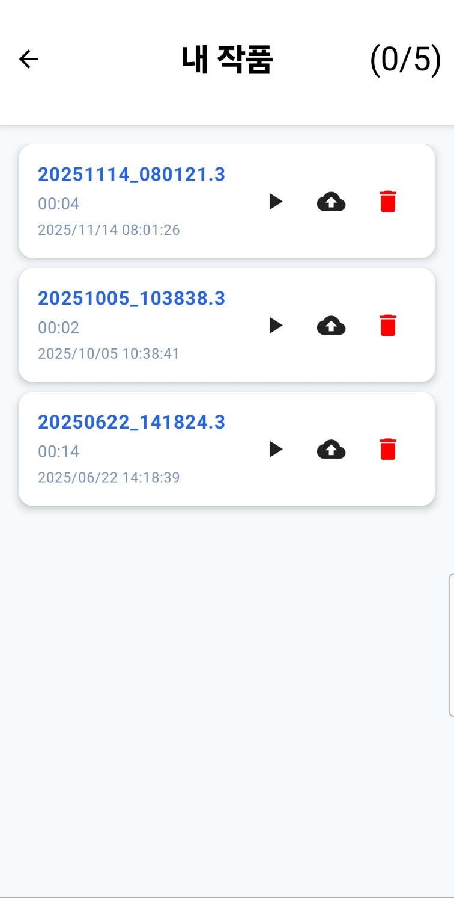
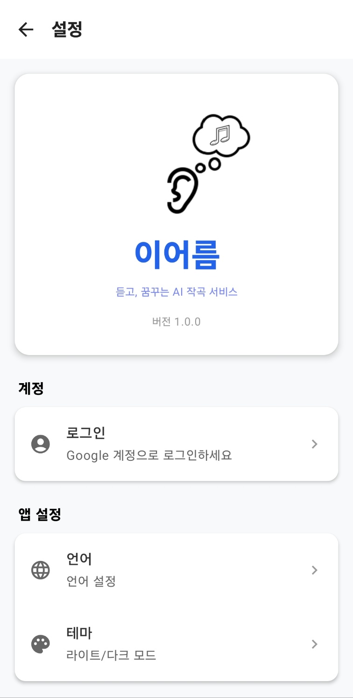

# Eaream - AI Humming-to-Sheet-Music App

[한국어 버전 보기 (Korean Version)](README_ko.md)

> An AI-powered Android app that turns humming into sheet music on the device

[]()
[]()
[]()
[]()

## Overview

Eaream is an Android app that converts the user's humming into sheet music (MusicXML and MIDI) with an AI model that runs on the device. Recordings are never sent to a server.
It focuses on an intuitive mobile UX, so that anyone without music theory knowledge can go from recording to sheet music in just a few taps.

## Screenshots
<div align="center">
    
    
    
    
</div>

### Project Info
- **Development period**: 2025.03.07 ~ 2025.12.19 (graduation project)
- **Environment**: Android Studio, Kotlin
- **Role**: Android client development (UI/UX, architecture design, the entire app)

### User Experience
- **Intuitive UI**: A simple interface that non-musicians can use easily
- **Multilingual**: Korean and English (modularized resources)

### Data Handling
- **No login**: Use it right away, with no sign-up or login
- **On the device only**: Recordings (WAV) and sheet music (MusicXML and MIDI) are stored only in the app's internal storage and Room. The app has no internet permission, and cloud backup is turned off.
- **Sharing**: Sheet music can be sent to other apps as MIDI or MusicXML files.

## On-Device Transcription

```
Humming recording (BPM, metronome) → Basic Pitch (LiteRT) → monophonic reduction, quantization, key estimation → MusicXML and MIDI → sheet music shown with OSMD
```

- Transcription runs as a WorkManager background job, so it keeps going when you leave the screen or the app is closed, and it never creates the same sheet music twice.
- Design decisions and the problems we ran into are written up in [docs/troubleshooting.md](docs/troubleshooting.md), and the things to check on a real device are in [docs/device-checklist.md](docs/device-checklist.md) (both in Korean).

## Android Architecture

### Overall Structure
```
📦 Eaream Android App
├── 📂 app (Application Module)
│   ├── manifests
│   ├── kotlin+java
│   │   └── com.largeblueberry.aicompose
│   ├── java (generated)
│   └── res
│
├── 📂 core (shared modules)
│   ├── data              # Room entities and DAOs, repository implementations, transcription pipeline, WorkManager jobs
│   ├── domain            # Domain models, repository interfaces, use cases (pure JVM)
│   ├── ml                # Runs the Basic Pitch model with LiteRT
│   ├── music             # Note creation, monophonic reduction, quantization, key estimation, MIDI and MusicXML output (pure JVM)
│   ├── navigation        # Navigation management
│   ├── resources         # Shared resources
│   └── ui                # Design system, shared components
│
├── 📂 feature (feature modules)
│   ├── library           # Recording management and transcription progress
│   ├── record            # Voice recording (BPM, count-in, metronome)
│   ├── setting           # App settings, languages, terms, open-source licenses
│   └── sheetmusic        # Sheet music view, MIDI playback, sharing
│
└── 📜 Gradle Scripts
```

### Key Technical Implementation

#### Architecture Patterns
- **Clean Architecture + MVVM**: Layer separation for scalability and testability
- **Multi-module architecture**: Modules split into core, data, domain, and feature units for faster builds and better code reuse
- **Single activity**: Efficient screen transitions with Navigation Compose

#### Module Roles
- **core**: Shared functionality, split into focused modules
- `navigation`: App-wide navigation management
- `ui`: Material 3-based design system
- `music`: The algorithms that decide transcription quality, split out as a pure JVM module so they can be tested without a device
- `ml`: Model execution (LiteRT) and the model file
- **data**: Local data (Room, DataStore), the transcription pipeline, and background jobs (WorkManager)
- **domain**: Business logic and use cases
- **feature**: An independent module for each screen

#### UI/UX
- **Jetpack Compose**: Fully migrated from XML to Compose
- **Material 3 Design**: Follows the latest design guidelines
- **Responsive UI**: Supports various screen sizes
- **Dark theme**: Follow the system setting, or choose light or dark yourself

#### Performance
- **Hilt dependency injection**: Less boilerplate and easier testing
- **Coroutines + Flow**: Asynchronous work and state management
- **Module separation**: Shorter build times and parallel builds

#### Audio Processing
- **AudioRecord API**: PCM WAV recording
- **Metronome**: Clicks played sample-accurately with AudioTrack
- **Permissions**: Only the microphone permission is requested

#### Data and Background Work
- **Room Database**: Recording and sheet music records
- **WorkManager**: Runs transcription independently of the screen lifecycle
- **LiteRT**: Runs the Basic Pitch model on the device
- **OpenSheetMusicDisplay (WebView)**: A sheet music renderer bundled in the app's assets, displayed without a network

## Tech Stack

### Development Environment
- **IDE**: Android Studio Narwhal
- **Language**: 100% Kotlin
- **Min SDK**: API 26
- **Target SDK**: API 35

### Key Libraries
- **UI**: Jetpack Compose, Material 3
- **Architecture**: Hilt, Navigation Compose, ViewModel
- **Async**: Coroutines, Flow
- **Database**: Room, DataStore
- **Background work**: WorkManager
- **On-device AI**: LiteRT, Spotify Basic Pitch
- **Sheet music rendering**: OpenSheetMusicDisplay (WebView)
- **Testing**: JUnit, Robolectric, kotlinx-coroutines-test, work-testing

## About Developer

**Developer**: Shin Yong-woo  
**Contact**: onlym3480@naver.com  
**Project type**: Graduation project (personal project)
