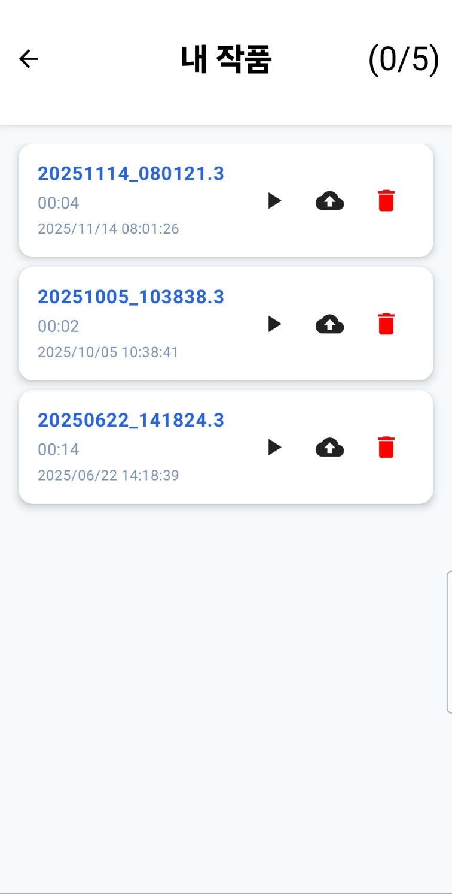
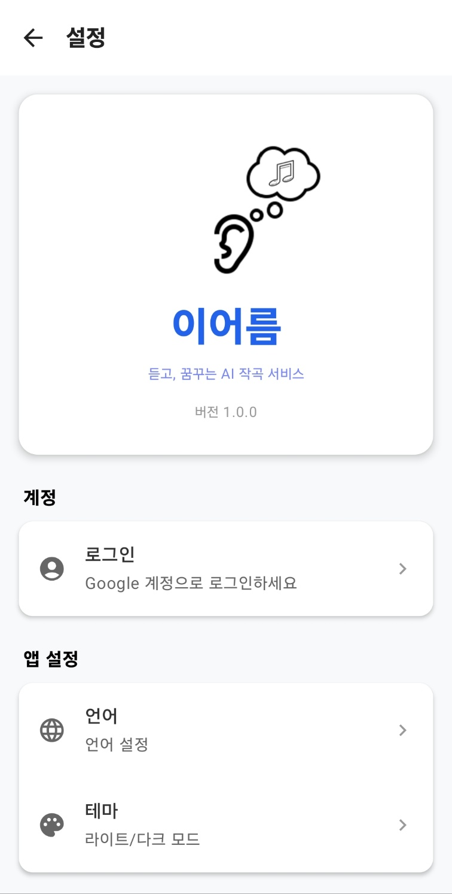

# 이어름 (Eaream) - AI 허밍 악보 생성 앱

[English Version](README.md)

> 허밍을 기기 안에서 악보로 변환하는 AI 기반 안드로이드 애플리케이션

[]()
[]()
[]()
[]()

## 프로젝트 개요

이어름은 사용자의 허밍을 기기 안의 AI 모델로 악보(MusicXML·MIDI)로 변환하는 안드로이드 애플리케이션입니다. 녹음은 서버로 보내지 않습니다.
음악 이론 지식이 없는 일반 사용자도 녹음부터 악보 생성까지 단 몇 번의 터치로 완성할 수 있는 직관적인 모바일 UX에 중점을 두고 개발했습니다.

## 앱 스크린샷
<div align="center">
    
    
    
    
</div>

### 개발 정보
- **개발 기간**: 2025.03.07 ~ 2025.12.19 (졸업작품)
- **개발 환경**: Android Studio, Kotlin
- **역할**: Android 클라이언트 개발 (UI/UX, 아키텍처 설계, 전체 앱 개발)

### 사용자 경험
- **직관적인 UI**: 음악 비전공자도 쉽게 사용할 수 있는 심플한 인터페이스
- **다국어 지원**: 한국어/영어 지원 (리소스 모듈화)

### 데이터 관리
- **로그인 없음**: 회원가입이나 로그인 없이 바로 사용
- **기기 안에서만**: 녹음(WAV)과 악보(MusicXML·MIDI)는 앱 내부 저장소와 Room에만 저장합니다. 인터넷 권한이 없고 클라우드 백업도 끕니다.
- **공유**: 만든 악보는 MIDI·MusicXML 파일로 다른 앱에 보낼 수 있습니다.

## 온디바이스 채보

```
허밍 녹음(BPM·메트로놈) → Basic Pitch(LiteRT) → 단성화·양자화·조성 추정 → MusicXML·MIDI → OSMD로 악보 표시
```

- 채보는 WorkManager 백그라운드 작업으로 돌아서, 화면을 떠나거나 앱이 종료돼도 이어지고 악보가 두 개 생기지 않습니다.
- 설계 결정과 부딪힌 문제는 [docs/troubleshooting.md](docs/troubleshooting.md), 기기에서 확인할 항목은 [docs/device-checklist.md](docs/device-checklist.md)에 정리했습니다.

## 안드로이드 아키텍처

### 전체 구조
```
📦 Eaream Android App
├── 📂 app (Application Module)
│   ├── manifests
│   ├── kotlin+java
│   │   └── com.largeblueberry.aicompose
│   ├── java (generated)
│   └── res
│
├── 📂 core (공통 모듈)
│   ├── data              # Room 엔티티·DAO, 저장소 구현, 채보 파이프라인, WorkManager 작업
│   ├── domain            # 도메인 모델, 저장소 인터페이스, 유스케이스 (순수 JVM)
│   ├── ml                # LiteRT로 Basic Pitch 모델 실행
│   ├── music             # 음표 만들기·단성화·양자화·조성 추정, MIDI·MusicXML 생성 (순수 JVM)
│   ├── navigation        # 네비게이션 관리
│   ├── resources         # 공통 리소스
│   └── ui                # 디자인 시스템, 공통 컴포넌트
│
├── 📂 feature (기능별 모듈)
│   ├── library           # 녹음 관리와 채보 진행 상태
│   ├── record            # 음성 녹음 (BPM·카운트인·메트로놈)
│   ├── setting           # 앱 설정, 다국어, 약관, 오픈소스 라이선스
│   └── sheetmusic        # 악보 보기·MIDI 재생·공유
│
└── 📜 Gradle Scripts
```

### 주요 기술적 구현

#### 아키텍처 패턴
- **Clean Architecture + MVVM**: 확장성과 테스트 용이성을 위한 계층 분리
- **멀티 모듈 아키텍처**: core, data, domain, feature 단위로 모듈을 분리하여 빌드 시간 최적화 및 코드 재사용성 향상
- **단일 액티비티**: Navigation Compose를 활용한 효율적인 화면 전환

#### 모듈별 역할
- **core**: 공통으로 사용되는 기능들을 세분화하여 관리
- `navigation`: 앱 전체 네비게이션 관리
- `ui`: Material 3 기반 디자인 시스템
- `music`: 채보 품질을 결정하는 알고리즘. 기기 없이 테스트하려고 순수 JVM 모듈로 분리
- `ml`: 모델 실행(LiteRT)과 모델 파일
- **data**: 로컬 데이터(Room, DataStore), 채보 파이프라인, 백그라운드 작업(WorkManager)
- **domain**: 비즈니스 로직과 유스케이스
- **feature**: 각 화면별 독립적인 기능 모듈

#### UI/UX 구현
- **Jetpack Compose**: XML에서 Compose로 전면 전환
- **Material 3 Design**: 최신 디자인 가이드라인 적용
- **반응형 UI**: 다양한 화면 크기 대응
- **다크 테마**: 시스템 설정을 따르거나 라이트·다크를 직접 선택

#### 성능 최적화
- **Hilt 의존성 주입**: 보일러플레이트 코드 감소 및 테스트 용이성
- **Coroutines + Flow**: 비동기 작업 및 상태 관리 최적화
- **모듈 분리**: 빌드 시간 단축 및 병렬 빌드 최적화

#### 오디오 처리
- **AudioRecord API**: PCM WAV 녹음
- **메트로놈**: AudioTrack으로 클릭을 샘플 단위로 재생
- **권한 관리**: 마이크 권한 하나만 요청

#### 데이터와 백그라운드 작업
- **Room Database**: 녹음·악보 정보 관리
- **WorkManager**: 화면 수명과 상관없이 채보 실행
- **LiteRT**: 기기 안에서 Basic Pitch 모델 실행
- **OpenSheetMusicDisplay (WebView)**: 앱 assets의 악보 렌더러, 네트워크 없이 표시

## 기술 스택

### 개발 환경
- **IDE**: Android Studio Narwhal
- **언어**: Kotlin 100%
- **최소 SDK**: API 26
- **타겟 SDK**: API 35

### 주요 라이브러리
- **UI**: Jetpack Compose, Material 3
- **아키텍처**: Hilt, Navigation Compose, ViewModel
- **비동기**: Coroutines, Flow
- **데이터베이스**: Room, DataStore
- **백그라운드 작업**: WorkManager
- **온디바이스 AI**: LiteRT, Spotify Basic Pitch
- **악보 렌더링**: OpenSheetMusicDisplay (WebView)
- **테스트**: JUnit, Robolectric, kotlinx-coroutines-test, work-testing

## About Developer

**개발자**: 신용우  
**연락처**: onlym3480@naver.com  
**프로젝트 성격**: 졸업작품 (개인 프로젝트)
